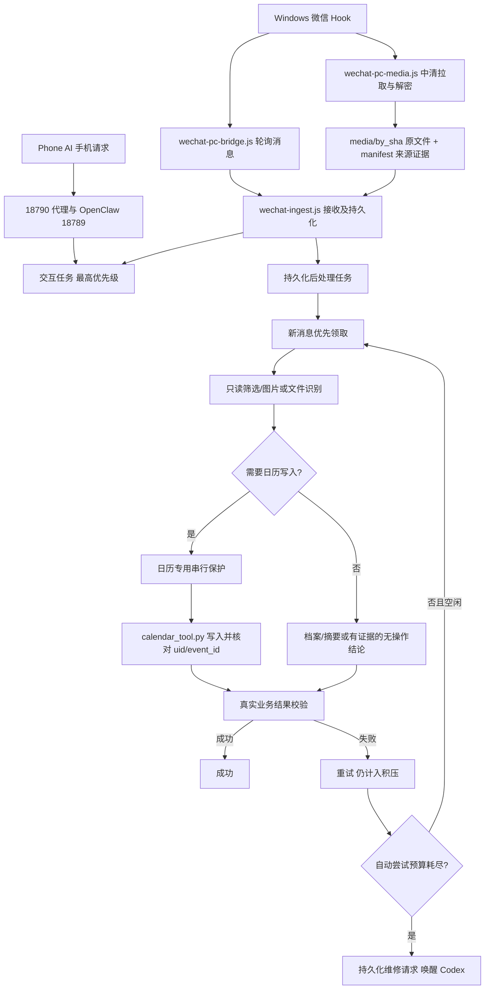
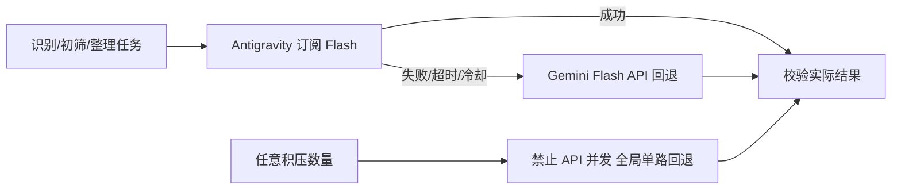
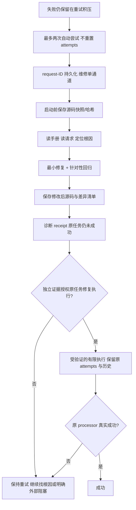

## 2026-11-12T11:33:51+08:00 当前验收：新消息0、重试0

本段为当前时点；下方历史非零统计仅为当时审计记录。使用网页同一 mediaQueueStatus / canonicalQueueCounts 合并媒体、后处理和记忆核验：new=0、retry=0、current=idle。未删除/归档未完成消息，未重置尝试次数。

最后监考原任务676592e886b453b2bc6b91fb已在原session完成工具更新并远端回查，原attempts=2保留。11月10日物理13:30–15:00为初三16班，化学15:30–16:30为初三12班。原失败为飞书190010限流，被错误归到模型限流；另旧传输没有发送location。现发送并回查title/location/times；未知写入先GET对账，仅190010且确定未落地时允许一次受控PATCH。不得把飞书限流当Gemini额度耗尽。

原会话完成回执校验现要求同源消息、真实工具成功及远端字段一致；自修复识别这些已核验完成凭据，保留旧repair_execution失败历史，不再次诊断同一成功任务。6项日历传输、4项最终回执、6项维修完成凭据检查通过。已解除本次人工maintenance并恢复repair-drain.timer；保留自动最多两次、修根因后受控恢复、Phone优先和闲时历史重试。Antigravity订阅Flash优先、Gemini Flash API单路回退；禁止API并发。

Phone AI Windows18880健康、phone_outbound已连接且pending=0（本次仅健康核验，没有新发手机用户任务）。gateway/ingest/dashboard/bridge/paid-gate均active。完整生产凭据与源码SHA见state/manual-repair-audit/direct-20261112/final-zero-verification.json。

---
以下保留历史时点记录。

## 2026-11-11 09:03 续修核验：新消息1、重试293，仍未完成

认证网页接口时点 2026-11-11T01:03:35.746Z；本次没有更改任何运行记录/次数来降低计数。完整336条媒体基线中累计真实完成73条，仍263条未完成；不能拿这个子基线代替网页合并积压。

本轮已部署：image_retry.py保存粗筛真实结果，只有同SHA缩略图已完成粗筛且needs_detail时才等待中清；不再花第二次预算重复识别。旧裸waiting_source标记不能阻塞网络失败。distill_media.py和media_dispatch.py在启动子进程前读取同份证据，避免等待图每两分钟空占slot。51项相关Python回归阻断网络通过。生产两条原图57454430226@chatroom的1690/1692均保持一次真实粗筛；定时器从processed2的空跑降为processed0，仍算重试。

继续定位到日历入口也会对同缩略图启动第二次child。wechat-ingest.js现用同SHA同份粗筛证据，在原processor之前等待60秒；保持queued、原错误、attempts/media_waits，源更新走既有校验刷新原job。三项新回归先复现失败再修，连同维修让位与补充证据共11项Node回归通过。已用controlled_ingest_reload.py等待子进程排空后重载，健康检查ok；未直接中断日历写入。此修复止住无效执行，不代表中清已下载。

本轮batch9实际逐张查看并记录9张普通物理练习/批注图，通过原accept_unit归档和回读；provider明确为codex-current-session，未伪称独立双读，未重放日历，attempts未清。本轮累计73/336，未完成263（以更新后的上述数字为准）。

4条人物记忆失败已只读重建当前原payload：2327/e0c8的精确请求持久缓存为remote-unknown，gate回执为生成阶段503 provider-transport-unavailable，不能盲重放；7f56的原请求回执not-submitted/provider-preflight-unavailable，但普通两次预算已用完；bb4b当前payload无精确缓存，不能由此证明历史未生成。没有将任一条记忆改成成功或续预算。证据current-memory-cache-audit.json、memory-gate-*.json。

尚未修通：Hook中清原生请求生成、缺失的旧视频/文件、复杂表格完整行列校验、unknown日历和上述4条记忆。自动维修恢复triggerImageCdnDownload后，当前cdn_native_trigger=false令autoHdDownloadPipeline立即返回；pending202只登记任务，不生成原生请求。没有开启directinvoke/entry/core/predownload或高清，不把这段修改称下载成功。当前Hook wrapper在线，部分请求已镜像成功，部分源未出现。

Antigravity订阅Flash优先→Gemini Flash API单路回退仍保留。订阅本周额度0至2026-11-13T23:44:00Z，禁止清额度块轮询；禁止API并发；普通最多两次，unknown先对账。剩余仍需继续修复。

本段生产源码SHA：
- /home/su/.openclaw/workspace-wechat/skills/wechat-media/image_retry.py：06c3d1448f74b576e7e36d7b3a332a4288460f26436ed094f5d7229145f26fcd
- /home/su/.openclaw/workspace-wechat/skills/wechat-media/distill_media.py：31132c146be1cde3d41a3d52457d5e1690306c6134dfed09eaceb2beea5fb1ed
- /home/su/.openclaw/workspace-wechat/skills/wechat-media/media_dispatch.py：1792fbf177e01a198af8db57e9cf2f6f02061ed3b52d5cef36d66201b1fd7aab
- /home/su/key_ctrler/wechat-ingest.js：f3e49112dbca793228c02879d5ab973a975682c6f6a8d3bf607cb8c7ab93d6ad

---
以下为历史时点记录。

## 2026-11-11 07:46 续修核验：新消息0、重试299，仍未完成

认证网页同源接口 verified-current.json 时点为2026-11-10T23:46:06.093Z。上一段07:27为309；两条原阅卷分工后处理真正成功后为307，本段又实际读取并归档8张原中清图片后为299。不是改名、剔除或清次数。全部54原job和145旧子媒体基线保留；完整336媒体基线保留，累计50条真实完成，仍286媒体未完成。媒体计数不能替代网页job/媒体/记忆合并后的299。

### 已部署的流程修复

- decrypt-wechat-dat.py完整验证WXGF候选容器，拒绝只看头部选出损坏JPEG。SHA 5c3547fcdbb471191ada717e05bc71d60e115b843b7689ae76cd5b1f5005a49a。
- vision_pipeline.py保留无Markdown外边框表格的真实边缘空格，兼容旧canonical；不补单元格、不降低逐格一致校验。SHA f3789da699b1ecfaa9b8196cf5e0a800a62e22e3e50776dea28627d855c4710b。cache_retry_proof和Node校验pin同步，旧merged-header授权pin未放宽。
- validate_repaired_ocr.py新增窄缓存恢复证明：原triage/generation在日历前失败，当前精确中清已具备真实完整Flash缓存，且原native DAT与当前SHA一致，才允许已有正式API恢复原job。拒绝未知副作用、无源、不同消息、弱缓存和已消费授权。SHA a4a3c0b8b567a8e84bfc116f069f2f67ebb284dedf167f4b36a7b71778feaedd。
- cached_middle_recovery.py接入现有repair_backlog_2489.run图像lane，不建队列或timer。闲时每tick最多核验并唤醒1原job；Phone/新消息优先；同一拒绝证据不反复解码，证据改变再验；传输失败60秒退避。只POST已有验证维修API，不称提交即成功，不增加普通模型预算。生产定时service在07:40已实际输出cached-middle-recovery eligible_ready=0，两条已经成功的原job未重复提交。

流程：中清Hook来源及SHA → 原媒体完整Flash识别缓存 → 闲时既有image维修tick → 只读完整proof → 已有原job维修API → 原processor核对日历 → 持久化真实成功回执。任何unknown先对账。

### 本段实际完成与日历核验

修订版监考表SHA 5ea1ec7286d2dc7243096631be4b24cfb2d1eba45aeb1d0b904eb8a0f9d17eb2的2原媒体由精确身份匹配的独立Flash缓存及原图表头核验恢复；1344483ed612b5a956be8490、8edc73e303f6609dce4a1e78均原job成功，attempts2保留、repair1。不是替旧版监考表套用新图结论。

6236154203806196f49c74d9、382d139a880a784239bc9db6原阅卷分工任务分别在07:32:28、07:33:25成功；前者本人初三物理第23题与已有集中阅卷日程一致，后者初二表无本人新增安排。OCR复用无新生成；原日历processor执行本身仍可能使用API，不把整轮称零API。

飞书只读query_live_events已核验remote_verified=true与event_id：11月10日语文08:00–10:00初三25班、物理13:30–15:00初三17班、化学15:30–16:30初三13班；11月11日07:30–11:30一初中机房初三物理集中阅卷第23题。证据calendar-and-hook-live.json；不重复写。

原图11张batch3加本段8张batch4/5经实际逐张view_image、SHA绑定、原accept_unit归档和回读。provider明确为codex-current-session，不冒称Flash或独立双读，不重放日历、不清attempts。batch4/5本段8张不发Flash请求。截图里被裁掉或模糊文字明确保留，不补写画面外文字。逐条证据codex-photo-<SHA>.json，输入文件inspected-images-batch3/4/5.json。

本段缓存晚到恢复6项、screen恢复8项、旧json恢复3项、verifiedOCR恢复6项通过，阻断网络；前段表格91项、照片缓存29项、cacheproof4项通过。另额外执行旧test_native_source_preflight时7项4失败，其“缩略图绝不允许粗筛”断言与用户后续允许普通照片缩略图粗筛不符；未改测试掩盖，不能声称全库测试通过。

### 服务与尚未解决事项

Phone AI实际18880健康ok=true，phone_outbound connected=true、pending0。原慢任务408d434d-74e2-4f6f-acc9-fde7d7748069已completed、pc_agent.status=ok，手机已ACK waiting及done；不能拿其他快任务没有ACK（不会生成延迟通知）判定丢消息。尚无本段新Phone请求端到端测试。

Hook真实GET /cdn/capture/status在线，main_dispatch_ready=true；/cdn/hook/status的404不是Hook失败。最近7条source_never_appeared中5条精确正式DAT存在，4条原消息已done/filtered，1条已middle卡在识别；另2条仍待精确追溯。capture_count0是RE捕获关闭，不能据此打开生产禁用的entry/core/predownload/directinvoke。未部署C++ DLL修改。

余项仍包括真实两读逐格不一致/缺行、旧视频或文件本地源缺失、部分Hook中清未到、4条人物记忆unknown/失败及一条日历最后执行结果未知。70份保存table结果本段复核仍全部未达完整校验，不能把有缓存当成功。Antigravity本周额度0、reset 2026-11-13T23:44:00Z，不轮询不清额度块；Gemini Flash API仍全局单并发、普通最多两次，未知写入不盲重放。

14份生产源码及diff/SHA快照见final-reviewed-source-audit.json。没有因为timer在线就声称299条会自动处理成功。

---
以下为历史时点记录，当前以上方最近核验为准。

# 微信 Agent 现行流程与维修手册

核实日期：2026-11-09。维护入口：`/home/su/key_ctrler/WECHAT_PIPELINE.md`。
本文记录运行链路、用户约束和验收边界；不是宣告全部功能已修复。
旧文档中的 Qwen 优先、等待高清、重置次数清积压均不再适用。API 发起始终单并发，只读处理不持有全局日历锁。
代码与本文冲突时先查真实调用和证据，报告冲突，不照抄旧规则。

## 先读与定位

后台维修开始前必须读本文和 `/home/su/.openclaw/workspace-wechat/AGENTS.md`。
启动器在执行时统一附上必读要求，旧 request 也适用；这不等于能证明模型真的读懂了。
先定位失败所处步骤、准确消息键、source SHA、异常和回执，再选择最小改动。
历史证据只定向搜索人物卡/对应会话/时间窗，禁止把全部历史灌给 LLM。

## 消息与媒体主流程



代码入口：
- Windows Hook/桥接：`wechat-pc-bridge.js`、`wechat-pc-media.js`。不要拿 WSL localhost 某端口不通当作 Windows Hook 未启动的证据；实际宿主从现行服务配置核对，不硬编码旧网关 IP。
- ingest/调度：`wechat-ingest.js`、`postprocess-repair.js`（选择器在 ingest 的实际导入模块中继续定位）。
- 媒体：`/home/su/.openclaw/workspace-wechat/skills/wechat-media/` 内 `distill_media.py`、`media_lib.py`、`vision_pipeline.py`、`media_dispatch.py`。
- 日历：`skills/wechat-calendar/`，写入只能通过 `calendar_tool.py`；禁止直接改 `calendar/tasks.ics`。
- 展示：`wechat-dashboard/server.js` 的 `canonicalQueueCounts` 合并 job 与 manifest 并去重。只看 jobs 文件不能代替网页真实总数。

### 图片与附件

只识别与消息键绑定的真实中清图，不等待高清、不主动补高清。
Hook 的中清自动拉取与模型识别是两个步骤：缺中清时先查 Hook 下载/解密/身份映射。
`fileType=2`、文件名或 captured_tier 标签都不能单独证明图片是中清。
中清 SHA 与缩略图 SHA 相同、仅有 thumbnail 或身份不匹配时，不得伪提升为中清。
文件摘要必须打开原文件；Excel 用精确表格解析，保留行列对应关系，不能凭几行片段猜整张监考表。
广告来源先筛选；不因清晰图后来到达而对无关广告重复识别。

## 模型与优先级



后台禁止 Pro、Argon、auto、Ollama；Pro 留给用户主动问答。
API 每月额度会恢复，不把某个月耗尽写成永久不可用。
2026-11-09 用户撤销 API 并发授权：积压超过50也禁止并发。ingest 普通槽位3、恢复槽位1只用于正常订阅调度；Gemini 付费代理在所有入口之间强制单路，环境变量不得开启 burst。
这些是执行通路，不是新的业务状态；API 处理完成不能再作为旧任务重跑。2026-11-09起撤销超过50自动并发的旧授权。
Phone AI 始终最高优先级；旧媒体重试不能挡住私聊新消息。
网络故障先按 `skills/clash-network-recovery/SKILL.md` 检查日本出口依赖的跳板订阅/节点，不能只刷新 GLOBAL。
日历写入串行，但无关只读识别不得长时间持有同一全局锁。

## 三种业务状态与验收

业务只允许：新消息、重试、成功。
当前调度内部 queued/running 是领取过程，网页映射为新消息；已有失败历史的排队任务映射为重试。
不得增加 needs-review/manual_review/repair_required 等第四种业务状态。
耗尽、等待外部证据、等待修复的失败仍属于重试，仍在总数中；不能删除/归档/换标签/缩窄统计使数字变小。
网页保留新消息数、重试数、CPU/GPU、当前任务进度，不展示累计成功数。

“成功”必须有该条消息的实际业务结果：
- 识别：对应真实文件和 SHA，结构完整，表格行映射校验通过。
- 无操作：模型实际读取后判断与本人无关/广告，保存可核验依据；不能看到错误便直接改 noop。
- 日历：工具返回 ok、真实 uid/event_id，并核对相应结果；outcome unknown 必须先查现存日历和会话回执，不能盲目重放写入。
- 导出：输出文件存在且重新打开核验。
进程 exit 0、Codex 维修 receipt、单测通过均不能替代这些业务验收。

## 两次失败后的维修闭环



普通维修不直接重放原消息、不手工改队列。现有 `repair_execution` 是带 fix_id、源 SHA、身份和验证证据的有限修复执行记录，不是额外状态。
维修 receipt 只表示诊断进程退出，不能自动恢复预算或凭 receipt 授权重放。
`_job_repair_already_completed` 必须检查任务已成功、repair_execution.pending=false、outcome=succeeded，且完成晚于请求；outcome=retry 不能算修好。
`terminal-resolution-v1` 仅用于其明确的终结证明；不能用该快捷分支吞掉 `verified-middle-dispatch-v2` 的实际处理。

### 重载协议

需要重载 ingest 时只用：

```bash
python3 /home/su/.openclaw/workspace-wechat/skills/wechat-media/controlled_ingest_reload.py
```

此工具负责写入 drain、等待已领取任务结束、重载、健康检查、清理自身屏障。
禁止直接 restart ingest、手写或删除 ingest-maintenance-pause，禁止杀死日历写入进程。
自修复临时维护标记 `state/codex-repair/manual-maintenance.json` 与 ingest drain 不同；人工维护结束必须恢复原维修 drain timer。

## 改动来源与追责

`codex_repair_launcher.py` 每次启动后台维修前后保存：
`state/codex-repair/changes-<request_id>/run-<id>/before/`、`after/`、`audit.json`。
审计包含请求ID、actor、时间、prompt哈希、源码路径及前后SHA；receipt引用审计位置。
只快照白名单源码/Markdown，不快照 .env/JSON配置、聊天、媒体、凭据、运行state或vendor。
目录私有、文件0600。一次请求重新启动保留独立run，不覆盖旧留档。
快照失败不启动无人值守维修；结束审计失败明确报告，不能把它宣告为完整成功。
范围内文件变化只能证明“该次维修运行期间发生”；若人工同时修改，必须结合 Codex file_change 日志确认作者，不能全部归给自修复。

2026-11-09已确认的历史证据：
- 请求 `e9ca11876d7d463e95447ad0c450547f`：自修复改媒体/表格校验代码，审计撤回4条不完整表格的错误完成，因而增加了真实可见重试。
- 请求 `264488296be34b5b984a639b92e4becc`：自修复改 ingest 与 postprocess-repair 的维修回执授权路径。
- 请求 `8ae9a5e3edad48109a5d07be63dd9fc6`：自修复改中清/缩略图SHA校验。
- “中清已就绪却被终结分支拦回”和“outcome=retry误判维修完成”两处最初引入者未查明；缺完整diff，不能可靠归给某一次维修。人工集成验收同样承担漏检责任。
- 人工本轮修复后任务 `43be92f4f4f1e4d272fd7c26`、`bff9ce1d6e20ef0732db4275` 已由 Antigravity Flash 原processor实际成功；不代表剩余重试已解决。

## 开始与结束维修的最低证据

1. 开始：失败任务ID/消息键、实际异常、源文件证据、流程图卡点、拟改文件；不输出密钥/完整聊天。
2. 修改：保留前后diff，回归必须能复现本次漏洞；不要只测函数能导入或进程能退出。
3. 部署：有必要才按受控重载协议；保留部署与健康回执。
4. 结束：分别报告代码修复验证、实际任务结果、仍未解决的数量和原因；不能用测试通过宣布清零。

### 历史媒体维修入口（2026-11-09）

10:24 后台请求 `7ca6c63dbb9d475096a74b94ddeaa978` 修复 dashboard 漏计及未限定会话/时间的 local_id 去重，旧失败因此重新可见；不能回退统计来降积压。
人工随后修复 `distill_media.py` 的前置扫描：已知广告先执行现行来源策略，显式追问仍保留；缺文件、旧隔离、耗尽预算及完成校验失败也必须能登记真实 Codex 维修请求，不能先被 file-only dispatcher/excluded 挡住。
每轮最多检查8个可登记维修项并让出 Phone AI；新鲜中清下载等待仍由 bridge 负责。请求登记不更改原消息状态、不重置次数、不授权模型重放。
回归入口：`python3 -m unittest test_distill_repair_safety test_repair_completion test_queue_completion test_vision_policy -q`（在媒体 skill 目录运行）。本轮43项通过，不能据此声称历史媒体业务完成。
审计：`state/manual-repair-audit/retry-surge-20261109/`；这是人工改动，与同期后台维修的文件改动分别归因。


## 人物记忆阶段与本轮维修（2026-11-09）

主任务成功不代表人物记忆成功。网页应计入未完成记忆；不能凭日历成功回执吞掉记忆积压。
记忆阶段只修改 memory_* 字段，不重放日历。真实合并回执保存 source_hash、completed_at 和 result.ok；重复消息只有完整源身份一致且有真实成功回执才复用。
源身份包含 talker/db/local_id/msg_svr_id/ts/type/content/text/is_send/sender；local_id 会复用，禁止单凭它去重。
纯表情/精确媒体占位符通过当前消息解析后返回 no-text 的真实 no-op；表情后有正文必须提取，禁止沿用旧 error 直接判成功。
旧预算耗尽只允许经 state/memory-repair-grants.json 的源哈希、原错误/次数与当前脚本版本验证后，执行一次记忆维修；保留原次数与错误审计，维修失败不能自行续预算。
新消息或 Phone AI 的 preflight 让路发生在模型调用之前：记录 dispatch/yield 后等待，不启动 Codex 维修、不耗实际推理预算；真正失败仍限两次。
历史回补按源时间合并，旧关系不能覆盖新关系、旧职责/任职不能复活或终止较新状态，同一职责证据不重复计数。
回归：key_ctrler/tests/memory-priority-yield.test.js、postprocess-scheduler.test.js、people-memory-fallback.test.py；付费代理单路用 skills/wechat-media/test_gemini_api_serial.py 验证，不发真实付费测试请求。

人物记忆维修通知独立于主任务：`memory_self_repair` / request `stage=memory`（旧格式 `memory-only:`）不能被主任务的 `self_repair_triggered_at` 或日历维修成功回执吞掉。维修启动器不得凭主任务成功结算记忆失败；记忆真实成功仍须同源 `memory_receipt.result.ok`。记忆维修禁止重放已成功的日历。

### 2026-11-10 前台功能故障维修

Antigravity `/usage` 显示 Gemini Models 周额度为0（五小时额度仍有余量不代表可用）；重置时间2026-11-13T23:44:00Z。不得改用 Pro/Argon 绕过。截图/文字翻译仍走原订阅，额度块过期后仅用 `/usage` 免费复查，确认可用才解除；损坏状态不能猜测放行。
碎碎念使用 OpenClaw simple-completion SDK；此接口不支持 agents.defaults.cliBackends，不能把 antigravity-exec 直接当成已注册 API 模型。遇到 CLI primary 时选该 agent 已配置的 google Flash API fallback；保留无工具与96输出token限制。完整任务的 CLI Antigravity优先链路不变。
Gemini gate 仍全局单路。显式 `X-Wechat-Priority: phone` 请求先于等待中的后台请求；不可抢占已提交的生成。碎碎念调用前也取得 Phone priority lease。网络报错时允许 `--task-transport-failed` 强制验证跳板，不能凭端点小探针成功认定实际请求已恢复。

验收补记：碎碎念 Google SDK 的 onPayload 参数是 GenerateContentParameters.config，不是 REST generationConfig；原代码未约束实际 config。该通路 MINIMAL 请求实际400，改为 LOW 后真实 HTTP200（19.55秒、20字中文）。同时校验 config.tools，维持96输出token、maxRetries=0。Phone bridge 在 pending=0 时重载。截图翻译真实 HTTP429 antigravity_quota_blocked（0.2秒），未生成图片，不能宣告翻译成功。
最近四个 Codex 自修复 JSONL 的 turn.failed 均为 CC Switch/Fenno HTTP403 Insufficient account balance，supervisor receipt=failed；job 中 self_repair.status=running 是原启动快照，不能据此声称仍在修复。不得把失败 receipt 当修好，也不得改用未授权账户。Dashboard 实际端口18801（环境配置），systemd 描述中的18800已过时。


### 2026-11-10 中清消费、缩略图初筛与 CPU 修复

调度器只有一个媒体执行槽。槽位已占满时只轮询子进程，不再每0.25秒重读约30MB清单、排序和扫描；子进程退出后重新核对Phone优先级再领任务。
中清预登记目标统一使用.middle.jpg；新源通知不能被旧推理预算挡住，但通知不重置attempts、不直接授权重放。
WXGF尾部8字节元数据会变化，以完整容器MD5验证24字节尾部；仍验证所有颜色平面。7条真实中清已解码并发布源证据，23条经既有只读校验授权一次修复执行；授权排队不是业务成功。
用户允许缩略图粗筛。精确SHA和有效图片核验后可交Flash只按可见主体分类；明确无日程/任务细节的普通照片可形成无操作结论。文档、表格、截图、海报、看不清或显式追问仍需中清，不做细字OCR、不据缩略图生成日历。Phone让路异常是InferenceUnavailable子类，必须先捕获InferenceYield并继续让路，不能触发API回退。
Dashboard CPU改为os.cpus全部逻辑核心的区间平均，标注WSL，0至100%；不是ps单核生命周期百分比求和，也不是Windows其他进程的总负载。GPU仍用驱动利用率，云端Flash不会使用本地GPU。
部署后66项媒体/修复回归通过，CPU计算回归通过。两次线上采样CPU为1.5%和1.8%；同期新消息71、重试268，尚未清零。不得以测试通过或更改计量方式宣告积压解决。
本轮审计：state/manual-repair-audit/middle-consumer-cpu-20261110/。Antigravity Gemini周额度仍为0；API全局单路，无burst；自动修复最近四次仍受Fenno账户余额403阻塞。


### 2026-11-10 限流与初筛费用修复（20时后）
用户提高了API上限，仍要求控制费用；提高额度不等于重新允许API并发。所有入口保持全局单路。
确认过量调用的一条路径：订阅初筛受额度阻塞时，context_calendar_pipeline直接把普通文字交完整日历Agent，导致多轮工具调用；现在订阅初筛失败后先走现有durable Flash API单次相关性初筛。模型判断无关且原有校验通过后才noop；相关或uncertain仍用完整日历Agent检索和执行。两路初筛均失败不再启动第二个付费Agent，不凭错误判无关。Phone让路异常不得触发API回退。
Google RESOURCE_EXHAUSTED会写入state/gemini-provider-backoff.json：只有凭证哈希、重试截止、白名单quota指标，无密钥/聊天。网关尊重RetryInfo并对重复拒绝递增等待；ingest在领取前读取同一等待，FlashClient也在提交前检查。此等待不是新的业务状态；失败任务仍计入重试。
网关已明确证明not-submitted且fingerprint匹配的预检，最多允许第二轮；保留原回执，不重放unknown/active/provider-complete。客户端同样要求精确回执证明且仍在原两次预算内；不重置attempts。
表格初读来自API回退时，也必须进入原独立逐格核验；不能因api_attempted直接跳过核验又拒绝结果。已有完整逐格核验缓存可复用。5条历史表格已由原distill验收完成，0新增模型调用，原次数不变。此前另2条精确附件接受成功，共7条真实验收，不代表队列清零。
verified-screen-fallback-v1只用于本次今日pc-hook纯文字、两次均耗尽且最后为缓存online-rate-limit的任务。独立校验部署的精确修复SHA、完整源身份唯一、历史API会话无任何工具调用、无匹配Antigravity整任务。任何未知写入、其他阶段或已有repair_execution均拒绝。只授权同一原任务一次修复执行，保留原attempts=2；授权queued不等于成功。23条通过静态独立检查，先提交1条真实验收成功，再提交剩余22条；23条现已由原processor全部真实成功，原attempts均保留为2，repair_execution.outcome=succeeded。逐条回执见screen-repair-acceptance.json。
自动修复Fenno账户403余额问题尚未解决，不声称后台Codex已经恢复。完整重试积压尚未清零。审计state/manual-repair-audit/retry-roots-20261110/。

精确恢复视频调度修复：distill不再无条件排除旧backlog-quarantined；仅原消息ID/时间/来源DB/完整源键/原MD5/当前SHA256同时匹配、无完成校验失败且原尝试小于2的视频可回到原调度。5条已验证进入候选序列，未计业务成功；Phone和新任务优先。20项针对性回归通过。

### 2026-11-10 20:43 自修复通路状态纠正
早先Fenno HTTP403余额错误只代表当时运行，不可继续当作当前阻塞。20:39:32请求f360ee5a2e074ab8ae5702463403e368的supervisor回执status=succeeded/exit_code=0，最近运行也已有turn.completed且无余额403；这仅证明维修执行通路恢复，不代表原业务任务或整个队列完成。Windows配置代理15721与WSL后台15722不同，不能据此推断不同账户或真实余额。诊断必须读取最新回执和日志，不沿用旧错误。

### 2026-11-10 21时后 只读让路与表头修复
修复9条verified-middle-upgrade-v1任务的真实调度矛盾：只读processor明确在日历前给新消息让路，但已消耗repair dispatch；旧选择器只接受attempts=0，重启后永久卡住。现在单独保留priority_yield_history，原attempts和repair lifetime attempts都不归零；只有精确只读回执可恢复，抛出异常/未知写入不能冒充让路。9条中8条已由原processor真实成功，另1条table-row-mapping-incomplete仍失败，不能宣布全部完成。4项针对性调度回归及23项相关回归通过。
表格转写要求保留合并空格，旧校验却要求第一行每列都非空；增加显式表头层数元数据，保留原矩阵、空白和层数，两次独立读取必须一致。45项表格回归通过。一次精确源/版本绑定的verified-merged-header-v1执行仍因模型未按格式输出而失败，保留retry，不续相同授权。
部分旧triage-providers-failed消息已由媒体管线产生真实Flash缓存。verified-flash-cache-v1只接受该已知只读失败、完整源身份/真实文件SHA、可信Flash缓存及当前triage无需推理即可消费的证明；文档后续仍走原OCR和日历验收。原次数/旧repair完整保留，同fix不续授权；HTTP202不是业务完成。先试1条普通照片已真实成功，再提交14条待实际验收。3项Python证明回归、4项JS授权回归通过，未调用付费模型测试。审计state/manual-repair-audit/repair-yield-20261110/。

### 2026-11-10 22时后 实际结果补记与网络检查
前节15条verified-flash-cache-v1执行已结束：13条原任务成功，2条后续日历相关性初筛HTTP503失败，仍计retry；不是15条全部成功。连同只读让路修复的8条，本轮24条日历后处理维修共21条成功、3条失败。另5条精确恢复视频中4条实际完成，1条原两次预算耗尽后仍失败。PDF原执行仍失败，不能计成功。22:02及后续检查网页新消息2、重试225，未清零。
同时修复vision_pipeline的重复API回退：subscription_answer内部已经试过durable API时，_ollama必须保留ProviderFallbackError并返回api_fallback_exhausted，_gemini不得再次使用另一层prompt发第二次付费请求。47项表格/回退回归通过；不会改变失败任务的业务状态。
新查7条online-calendar-failed均不满足完成会话回读证明；4条是旧Antigravity任务输入冲突，3条是gateway不可用，不直接重放。旧执行结果不明仍需对账。
跳板检查存在普通GET成功、真实API TLS连接仍失败的缺口。恢复器已改为在有现有凭据时通过同一代理连续两次免费countTokens POST，第二次连接失败即拒绝候选；不发generateContent，不绕过认证/配额，API保持全局单路。5项针对性测试通过，部署后两次真实countTokens均200。网络探针成功仅证明该次通路可用，不代表业务已完成。审计state/manual-repair-audit/repair-yield-20261110/network-probe/。

22:20后补记：上述PDF已有真实修复结果。确认原durable请求API attempts=1，gate精确fingerprint回执not-submitted/503，无provider_response，并在网络免费预检通过后沿用同一请求ID执行原剩余预算一次。返回3页实际转写；原summarize_file在禁止所有新模型调用时成功消费该缓存，既有accept_unit按同源SHA验收3条来源并验证搜索归档，全部原vision_attempts保持不变。网页按自身去重规则只减少1，不把3条来源记录冒充3个业务计数。
13条记忆503已按实际输入重建durable键：10条原生成attempts=0/failed（免费预检失败），2条remote-unknown/1，1条remote-unknown/2。只对前10条串行执行各一次原请求：9条得到有效people结果，1条503仍失败且未续跑。其余未知结果不重放。
memory-cached-extraction-v1只用于原memory-phase-receipts维修已明确失败、完整源hash/原started_at/次数匹配且新Flash缓存完整的记录。启动器检查当前ingest/people源码SHA、缓存bytes SHA和实际people数组，保存旧memory_repair至history，原memory_attempts原样保留。原记忆processor使用WECHAT_PEOPLE_CACHE_ONLY，只消费同一当前prompt对应的durable结果；缓存缺失或上下文变化不得重新推理，不能重放日历。9条已全部真实合并成功，memory_receipt.result.ok=true；逐项对照原主任务event/status/attempts/result均未改变。新增7项针对性测试、既有34项记忆/调度测试通过。
22:31:44网页实际新消息3、重试215，尚未清零。当前仍有缺少原附件的媒体、未知日历/模型结果以及格式或供应商失败，仍保留在原业务统计中。审计network-probe/memory-merge-acceptance.json及pdf-acceptance.json；自动维修timer保持开启。


### 2026-11-10深夜至11日00:12 真实恢复与空转修复

验收未清零：11日00:12:31认证网页实际新消息0、重试203，WSL CPU1.0%。此前23:10:38快照为0/215；不能只统计jobs文件或把失败移出网页。
本段审计目录：`state/manual-repair-audit/repair-yield-20261110/`。

1. 原始type47动画表情由唯一精确pc-hook转录证明为无任务反应，两条真实完成，未调用模型、未重置原次数。显式追问及真实图片不走此结论。证据在emoji-preprocess/。
2. 视频桥原先在unsupported_kind之前丢失XML/local/server身份，已改为先持久化原身份，再按当前XML MD5及明确备选绑定实际MP4；只流式hash/copy。已做真实原生视频字节校验，但该样本历史上已处理，不能算新增清积压；大量历史视频仍缺文件。预算耗尽仍可接收新来源通知，但不授权再次推理。证据在video-bridge/。
3. readonly_handoff.py对固定CLI版本的SQLite步骤做只读核验，只接受明确零轮认证失败或已完成、仅含read_file的额度失败；任意命令/写入/子轨迹/未知结果均拒绝。readonly_calendar_proof.py还核对同源全部API会话均无工具、精确最终失败会话及源版本。首批6条原日历任务中5条真实成功noop，1条初筛返回格式失败仍retry；没有新建日历事件。
4. 7条历史429另经同一只读证明恢复，原始attempts=2保持不变。最先一条在免费countTokens阶段HTTP400、durable attempts=0；修复下述格式错误后，其余6条全部真实成功noop。该400项仅凭原始只读执行、严格失败阶段、唯一零生成请求及修复源码hash，取得一次verified-json-schema-preflight-v1执行；旧失败执行完整保存在history，原processor最终真实成功noop。该授权不得重复，不能用于unknown/已发送/有工具的失败。逐条见readonly-calendar/rate-limit-acceptance.json与schema-preflight-acceptance.json。

初筛返回ValueError的真实根因：订阅失败后API分支漏传必填JSON契约，回答可遗漏unchanged_event_uids；后来补契约时暴露第二处不兼容：FlashClient把含additionalProperties的完整JSON Schema传入Google简化responseSchema字段，真实免费预检400。已使用responseJsonSchema保留原契约；用相同无敏感fixture预检实测200。严格校验保持，不能给失败回答补空证据后当成功。订阅Flash仍优先，失败才走全局单路Flash API，不启动第二个付费完整Agent兜底初筛失败。

CPU空转有真实栈证据：两个distill协调进程持续占各一个核心，卡在request_stranded_media_repairs；每个已耗尽维修启动次数的旧项都先重新解析38MB任务队列两次。已先判资格，再检查优先级；对队列按路径/device/inode/size/mtime_ns/ctime_ns缓存纯优先级事实，原子替换立即失效，到期时间每次现算；损坏/并发变化仍让路，不保存完整聊天。真实队列只读扫描8个候选由4.881秒降到0.301秒。Phone与新消息优先规则未放宽，已耗尽记录仍计retry。

针对性验证：CPU/媒体17项、队列优先级16项、结构与初筛24项、既有缓存/单路8项；后续只读恢复证明7项、JS授权4项、最终订阅路由13项通过，均不发付费测试生成。两条旧路由单测仍断言初筛失败直接转完整Agent，已按当前节费流程修正，未降低业务校验。

剩余阻塞不能按成功处理。旧表格83来源对应74个SHA，旧回答缺完整逐格校验；重读缓存未找到可直接验收的完整证明。仅选1张已证实中清的原表格做最多两次独立读取，首读生成连接RemoteDisconnected/503即停止；durable状态remote-unknown、attempts=1，不续发、不声称无费用，也未增加成功数。原媒体及失败保留，证据在table-native-repair/。
11日另调用既有clash-network-recovery：首个低延时跳板Google TLS失败，第二个通过两次认证免费countTokens和订阅端点检查。只切跳板，保留固定日本出口及其他选择器；refreshed_providers为空，未宣称刷新订阅。小探针成功仍不能证明该未知生成完成，禁止因此重放。全局API单路保持，桥/ingest/dashboard/gate及自修复timer均active。


### 2026-11-11 00:13至01时后 缓存、归档与真实表格维修

00:45认证网页0/200，本段开始前为0/203，前三项使网页真实减少3：
1. verified-flash-cache-v1 的 Python/JS pin仍指向防重复API回退修复前的vision源码，导致真实Flash缓存证明一律拒绝。已核对版本差异并同步仅缓存分支pin；merged-header旧授权未放宽。原任务2517e4868e20818a3d77b1e9实际成功，未新生成。
2. Office Tool Plus ZIP含600成员，旧逐组件元数据拼接超过120000字。software_archive_input对支持的软件包完整CRC读取/逐成员SHA、所有PE静态资源/完整JSON/文本解析，覆盖证据私有保存，聚合重复依赖而非截断。真实全包14.81秒，模型输入3612字；一次Flash生成后原accept_unit完成，原vision_attempts=9保留。不得把此静态软件结构摘要称为运行测试或安全分析。
3. 记忆10faa597cc513c99a30b6df7原503仅预检失败、生成attempts0；精确原prompt一次生成后cache-only原记忆processor真实合并成功，未动已成功日历或主任务。

01时前后继续发现表格验收的三个具体代码错误：
- 显式表头加一条完整数据原本被至少三行规则拒绝。现在显式层数要求至少header_depth+1行，至少2行；无显式元数据的旧格式仍保持三行要求。
- 多表区中的无表头矩阵必须记录header_depth=0，完整保留物理矩阵和全部空格。不能从前一区复制日期标题，也不能用任意正文绕过矩阵。
- JSON中同一单元格印有多行日期/星期时允许格内换行；转为文本仅合并格内换行，原始结构化回答留在durable缓存。竖线/tab等歧义分隔符、未知/模糊字、缺列及两读不一致仍拒绝。

真实验收：ac509116...课程单行表两次独立读取一致，原accept_unit完成1来源；它被网页按完整消息身份去重，网页没有因此下降，不冒充清积压。32e8f12f...中晚餐菜单首次已有完整生成但被格内换行拒绝；修复后只读首次durable缓存，再执行原定第二次独立读取，两读完全一致，原accept_unit完成1来源，网页0/200→0/199。旧checkpoint保留，continuation明确只消耗第二次读取；不续失败维修预算。
现行consumer变更同步缓存Python/JS精确SHA并通过真实部署版本回归，merged-header旧授权仍原样。48项表格回归、9项缓存/日期/监考回归、4项JS授权回归通过，测试不发付费生成。

FlashClient另修复有I1标签且提供显式schema时同时发送responseSchema与responseJsonSchema的冲突。显式schema独占契约，原普通批次保留I1身份约束。2项直接契约回归及既有13项结构/全局单并发回归通过。API全局仍单路，无burst，Phone第一、新消息第二。

本次查数严格使用网页canonicalQueueCounts：0/200时54条未完成后处理(含4条记忆)+146条未完成且未被后处理覆盖的媒体，非直接把manifest83条表格作为网页83。菜单完成后媒体145，网页199。原消息和次数未删改，未归档降数。

01时源依赖检查发现Hook登录在线且session.db可读，但message_0.db/1.db句柄缺失；桥每5秒重复发现，游标文件停在00:50。因此网页new=0不能作为无漏收证据。只读附件重查因无消息库中止，未写not-found判决。历史缺原文件不能靠模型重试完成。
原部署记录与候选旧DLL哈希均为5CBACD4E...，确认同一构建。候选xdb/db_mgr.cpp将SQLite上一条SQL的errcode==OK当连接存活检查，真实SQLite在缺表/唯一约束失败后仍是有效连接却被过滤，回归可复现。现最小补丁仅允许已知SQL结果继续接受原mutex+PRAGMA database_list核验，MISUSE/损坏/未知码仍拒绝；不改偏移、中清、下载或凭据。3项真实SQLite回归通过，仅重编译db_mgr.obj。安装由ops/db-discovery-20261111/install.ps1校验新旧哈希及回滚，Windows Program Files需要管理员授权。安装/恢复结果应以install-result及后续真实DB探针为准，编译成功不代表线上恢复。
审计：state/manual-repair-audit/retry-stall-20261111/。新DLL、旧DLL、完整安装脚本/配置及build.log在Windows工作区ops/db-discovery-20261111/。所有unknown生成/写入保持先对账，不盲重放。

后续补记：Windows提权返回“操作已被用户取消”，install-result.json未生成；原生DLL未替换，微信未重启。数据库补丁仅完成构建及3项真实SQLite回归，线上message库恢复尚未验收。不得声称消息收取已恢复或new=0代表无漏收。
另确认provider_fallback.infer虽接收schema，却在API call漏传；现仅schema非空时向durable通路传递，旧无schema请求身份不变。2项API契约、2项fallback契约与既有结构/单并发共17项通过；不发付费测试调用。已受控重载ingest并健康。
最终本段真实网页统计见retry-stall-20261111/final-current.json；仍有199条重试，不改名/隐藏/归档/删消息，不把尚未安装的补丁算线上成功。


### 2026-11-11 数据库补丁已安装，及两份改名 Excel 原任务验收

本节更新此前“提权取消、尚未安装”的记录：用户随后明确授权安装及重启，install-result.json 已确认成功。线上 DLL SHA256=29d4fa7fffcede89f1b802679f6ccd81060998916a3d369313def7b4b80ce846。用户已确认聊天界面。三轮实际缺表 SQL 后仍能发现 message_0.db 并读取163张表；后续复查22个数据库。证据 state/manual-repair-audit/retry-flow-20261111/db-stability-after-install.json。

原生文件定位曾只按原文件名查缓存，微信加“(1)”后导致真实文件存在仍报file_not_found。wechat-pc-media.js 现仅在原消息具有正数大小和完整MD5时，按大小筛选后完整MD5比对，复制后核验SHA；不凭相似名称猜来源。native-file-digests.js 为未改变的真实文件版本缓存流式MD5/SHA，文件版本/流读取期间变更均拒绝旧缓存，避免历史视频逐条重复全目录hash。9项针对性回归通过。

01:58桥接服务已加载新模块，279个last_session会话读取位置未变，未重启ingest。证据bridge-reload.json。两份Excel实际读完3+1个工作表，正文7957/3789字符，Flash返回摘要，accept_unit归档后原记录done；源SHA、完整正文和归档均回读通过。原vision_attempts=1保留，各在共同维修账本记一次；不重放9月历史日历。恢复驱动ops/complete-recovered-workbooks-20261111.py仅限定这两条，结果先持久化，重复运行already_completed=2且不调用模型。

当前网页新消息0、重试197（原199减去两条真实完成）。尚未清零。25条image-tier-not-ready没有可验证中清字节；另1条虽有本地DAT但中清SHA与缩略图相同，未通过来源验收。两条本地视频仍持有file-lane旧inflight且无保存回执，领取返回stale，本轮未提交视频模型请求，禁止仅因主维修账本未记录就重放。人物记忆旧grant的哈希不适配当前代码，不通过只换hash扩大执行预算。诊断或进程退出不等于这些任务已完成。


## 2026-11-11 澄清任务后续证据对账

原消息只读事件时间之前的上下文；补充证据不伪装成本人直接回答。
`clarification_followup.py` 验证原 Antigravity 会话仅有只读工具、无另一路写入执行者，绑定同会话原始补充消息的行号和 SHA。
`clarification-followup.js` 仅唤醒仍有普通预算的原 clarify 任务，原 event 和 attempts 不重置；再次执行前复核原文，后续各条保留发布时间。
同会话消息稳定30秒后再对账，最多12条/4000字符，旧任务仍走空闲重试优先级；两次耗尽或未知副作用不自动重放。
重新处理仍须走实际 processor 和业务验收，收到新证据或启动成功均不代表任务完成。

最新授权继续有效：Gemini API 单并发，禁止任何积压阈值重新开启 burst。

本人主动回复澄清时，保留原 attempts 并清除过期 retry_exhausted；已用尽两次的任务保留真实回答到 clarification_received，不归档、不重置、不自动重放。


### 2026-11-11 返回格式失败与调用来源

provider_fallback结果通过对象属性保留实际provider/model，不能从模型JSON认领来源。初筛返回无效relevance时保留失败而非另开_gemini_api；空正文和结构化图片/文件摘要失效时保留API已尝试事实，禁止外层换prompt重复回退。合法表格的原定独立核验仍保留。39项Python与6项调度回归均无真实模型生成，受控加载后健康。
fetchExactMessageRow按原媒体类型过滤同秒消息，同类型歧义仍拒绝；相同完整身份但原文字节不一致必须报message-source-conflict，不能Map覆盖。原积压取源验收另记，修代码本身不算原消息完成。


## 2026-11-11 05:44 实际维修进展：尚未清零

认证网页同源接口为新消息0、重试338。本段续接开始时343，实际完成5条原媒体；此前344到343来自一条真实表格完成。193/190/197均是历史时点或不完整的旧口径，不是现状。当前统计保留“日历已成功但附件仍失败”的原消息，不能退回只数后处理任务。

5条课堂照片均由当前Codex实际查看对应原生中清字节，走原accept_unit归档及回读验收；summary_provider明确记为codex-current-session，不冒称Flash、不伪造两读一致。4条已有日历成功回执，1条无后处理任务；均未重放日历，原attempts未清。逐条证据为codex-inspected-classroom-photo.json、codex-photo-<SHA>.json。

### 已修的流程问题

日历初筛与媒体整理会分别识别同一普通照片：前者成功不代表后者完成。vision_calendar_bridge现在同次分类要求事实摘要、置信度和直接证据；image_store.cache_triage_photo只在可信Flash实际返回irrelevant/photo、完整摘要和证据、置信度>=0.6、源SHA一致且没有用户细读请求时共享到现有thumb缓存。媒体整理原入口先读缓存，无须另付费生成。旧分类缺摘要、表格/文档、不确定、低置信度、未知来源及显式细读均不能用此结论完成；并发已有详细结果不能被初筛覆盖。没有新增业务状态。

新增回归先复现“同图初筛后仍走reserve_summary和第二次识别”，修后通过；并补充同一SHA的初筛与媒体整理共用现有逐图锁，覆盖两者同时到达的情况，不持有全局日历锁。连同已有来源/预算/缓存回归共29项通过。测试阻断requests及urllib真实网络，不发付费测试请求。受控重载后health.ok=true，最终ingest PID2585914。Phone AI实际18880的/health返回ok=true、phone_control.connected=true，transport=phone_outbound；18790由svchost遗留portproxy监听，不能用它验收Phone AI，旧WSL同名proxy未启动也不代表Phone AI挂了。旧重试优先级未提升，Gemini API仍全局单并发。

之前相邻JSON表区分别校验通过、序列化后却被当成一个表拒绝的错误也已修复：只有缺原文标题的相邻表区加转写结构标记，已有标题保持原文；不改变原表格行列。77项表格/缓存/单路回归通过。最终vision_pipeline SHA为bb30b9d28b9548c3b8ba9d3ac695e327cb626a396aaa7de3225d30a2d0278ea3。merged-header旧授权pin未放宽。最终含标题修正的diff已保存在final-reviewed-sources/。

### 原积压及仍未解决的真实问题

全量基线full-remaining-baseline.json的336条原媒体不可覆盖。本段此前完成8条，本次再完成5条，共13条；仍323条媒体未完成，全部保留，attempts未清。网页338是job/媒体/记忆按消息身份合并后的数，不能直接用323或旧145条媒体基线代替。

- 3条generation-invalid-json：发现3份残留同名error但status=complete的durable记录，尚未与这3条原任务的精确prompt/schema/源字节匹配。已尝试原始初筛及42组摘要身份核对，未匹配，不猜测映射、不再次付费生成、不宣称恢复。
- 多数表格仍没有完整可靠转写。已保存两读复算不调用模型；33/32行、40/41行、112/40行及逐格不一致仍失败。不能因解析器修好了便认为模型遗漏的行也恢复。
- 本段前3个表格来源的原定6次独立Flash API读取中1源完成、2源不一致；失败checkpoint保留，不续两次预算。此前同段8源15次与这6次合计21次，仅是该组结构化表格读数，不是全系统API总量。
- 68条已能核对视频消息原始MD5，但本地缓存没有视频；另有原文缺MD5/原消息未找到/同类型身份歧义等。不能拿缩略图、相似文件名或mtime近邻替代。2个旧视频生成结果未知，仍禁止重放。
- Hook中清源依赖尚未全通。33条磁盘核对中8条精确native DAT存在，密钥有效；2条WXGF本地解码实际成功，1条与原缩略图相似度0.9936，已真实接回中清并完成上述5图之一；另一条相似度0.535拒绝接源。source_never_appeared仍有7条，不能称下载全通。
- 1条日历超时最后执行无精确副作用回执。较早会话仅有模型错误且无toolCall，不足以证明后来那次执行无副作用；仍不重放写入。
- 4条人物记忆与memory-compact旧unknown尚未全部解决；未来压缩调用已改durable单路，旧unknown仍保留保护，未全量重新压缩289个派生日桶。派生日桶不是新增289条原消息积压。

此前有一次fixture测试漏mock发起真实API调用，已报告；后来网络阻断回归不再重复。不能把整轮称为“零API”。本次5图维修、缓存身份核对和29项新回归没有额外Flash生成请求。

缺文件跳过路径另已只读核查：未找到“因旧路径非空被两轮补源清单同时漏掉”的原记录（skipped-source-inventory.json为0条）。旧WeChat Files目录也未找到MP4/常见文档扩展名的附件；不是凭没文件的错误名称直接推断来源已丢。

统一源码快照、SHA及可用前后diff：state/manual-repair-audit/retry-flow-20261111/final-reviewed-source-audit.json。网页真实数见verified-current.json，全336条保留核验见full-baseline-preservation-verified.json。自动维修drain/media-repair/distill timers保持active，但进程退出或timer在线不代表338条已处理完。
